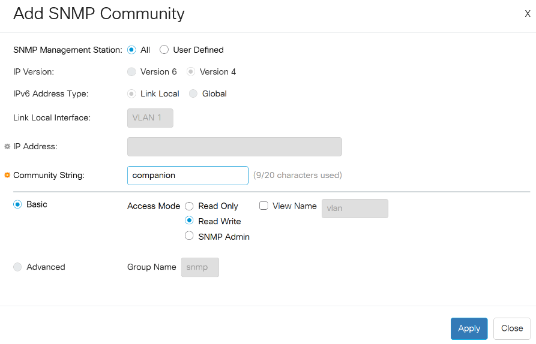

## Cisco CBS350

Controls Cisco CBS350 switches via SNMP: read the VLAN of each port, change the access VLAN of a port, switch
ports between access and trunk mode, control PoE, and recall complete port layouts (profiles).

Tested on a CBS350-8P-2G with firmware 3.5.3.2.

### Prerequisite: enable SNMP on the switch

SNMP is disabled by factory default. The module needs **SNMP enabled** and an **SNMP v2c community with Read-Write
access**. Choose one of the two methods below.

**Web interface**

1. Log in to the switch web interface.
2. In the page header, switch the **Display Mode** from **Basic** to **Advanced**. In Basic mode, the **SNMP** menu is
   hidden.
3. **Security > TCP/UDP Services**: check **SNMP Service**, then click **Apply**.
4. **SNMP > Communities**: click **Add**, then set:
   - **SNMP Management Station**: **User Defined** with the IP address of the Companion computer (recommended), or **All**
   - **Community String**: a name of your choice, e.g. `companion`
   - **Basic**, **Access Mode**: **Read Write** (leave **View Name** unchecked)
5. Click **Apply**.

   

6. Click the **Save** icon at the top of the page so the settings survive a reboot.

**CLI** (SSH or console)

```
configure terminal
snmp-server server
snmp-server community companion rw 192.168.1.10
end
write memory
```

Replace `companion` with your community name and `192.168.1.10` with the IP address of the Companion computer.
Without the IP address, any device can use the community.

> SNMP v2c sends the community in clear text, and a Read-Write community allows changing the switch configuration.
> Restrict it to the Companion IP address and keep the switch management on a trusted network.

### Configuration

- **Switch IP**: management IP address of the switch.
- **SNMP v2c community (Read-Write)**: the community created above.
- **Polling interval**: how often the switch state is read (default 10 s).
- **Save running-config to startup-config after each change**: when checked, every change is saved immediately. When
  unchecked, changes stay in the running-config until the **Save config** action is used, and are lost if the switch
  reboots.
- **Protected ports**: ports that are never modified, reset or power-cycled by the module, e.g. the uplinks `9,10`.
  Protect at least the port that connects the switch to Companion.
- **Profiles 1-8**: name and content of the profile slots (see Profiles below).

### Presets

The presets work with a **selected port**: press a port button first, then the buttons of the **VLANs** and
**Selected port** sections act on that port. The **Ports** and **VLANs** presets are generated from the switch, so they
appear once the module has read it.

**Quick start**

1. Press a **Ports** button to select a port.
2. Press a **VLANs** button to move the selected port to that VLAN.
3. Press **Save config** when you want to keep the changes (it turns orange when there are unsaved changes).

**Ports**: one button per port, showing the port name and its VLAN (`1013` for an access port, `T 1` for a trunk with
native VLAN 1). Pressing it selects the port.

| Color       | Meaning                                              |
| ----------- | ---------------------------------------------------- |
| Red         | Link down                                            |
| Green       | Link up                                              |
| Yellow text | Link up below 1 Gb/s (100 Mb/s device, bad cable...) |
| Grey        | Port disabled (shutdown)                             |
| Orange      | Selected port (takes priority over the other colors) |

**VLANs**: one button per VLAN of the switch, showing its id and name. Pressing it puts the selected port in access
mode on that VLAN (also from trunk mode). The button is light blue when the selected port is on that VLAN.

**Selected port**

| Preset              | Shows                                         | On press                                         | Colors                                                              |
| ------------------- | --------------------------------------------- | ------------------------------------------------ | ------------------------------------------------------------------- |
| Selected port info  | Port name and speed, VLAN name, LLDP neighbor | -                                                | Red = link down, green = up, yellow text = below 1 Gb/s             |
| Description         | Port name and description                     | -                                                | -                                                                   |
| LLDP neighbor       | Name of the connected device and its port     | -                                                | -                                                                   |
| TRUNK               | -                                             | Trunk mode, all VLANs tagged, native VLAN 1      | White when the port is a trunk                                      |
| ACCESS              | -                                             | Back to access mode on the previous access VLAN  | White when the port is in access mode                               |
| Reset Link          | -                                             | Shut / no shut, the device renews its DHCP lease | -                                                                   |
| Reset PoE           | -                                             | Cuts the PoE power for 5 s to restart the device | -                                                                   |
| PoE on/off          | PoE state and power                           | Toggles PoE (off is `power inline never`)        | Dark green = PoE on, green = delivering power, grey = off or no PoE |
| Port enable/disable | Whether the port is enabled                   | Toggles the port (disabled is `shutdown`)        | Green = enabled, grey = disabled                                    |

To use another native VLAN for TRUNK, or another power off duration for Reset PoE, edit the action options of the
button.

**Profiles**: one select button per profile slot, showing the profile name, plus **STORE** and **RECALL** buttons
acting on the selected slot (see Profiles below).

| Preset         | On press                                                                  | Colors                                                   |
| -------------- | ------------------------------------------------------------------------- | -------------------------------------------------------- |
| Profile 1 to 8 | Selects the profile slot                                                  | Orange = selected, blue = the switch matches the profile |
| STORE          | Stores the current layout of all non-protected ports in the selected slot | -                                                        |
| RECALL         | Applies the selected profile                                              | Blue when the switch already matches the profile         |

**Switch**: **Save config** saves the running-config to the startup-config (`write memory`). It is orange when the
module made changes that are not saved yet.

### Actions

Most port actions exist for a given port and for the selected port.

- **Select port**
- **Set access VLAN**: puts the port in access mode on the VLAN, also from trunk mode.
- **Set mode (access/trunk)**: access keeps the previous access VLAN; trunk carries all VLANs tagged, with a selectable
  native (untagged) VLAN.
- **Reset link (shut / no shut)**: renews the link, which forces the device to renew its DHCP lease.
- **Reset PoE**: power-cycles the connected device (PoE off for a configurable duration, then on).
- **Set PoE**: on / off / toggle. Off is `power inline never`.
- **Enable / disable**: on / off / toggle. Disable is `shutdown`.
- **Set description**: port description, supports variables. Empty clears it.
- **Apply profile**, **Select / Store / Recall / Rename profile**: see Profiles below.
- **Save running-config to startup-config**
- **Refresh status**

The VLAN changing actions also have a **Reset link after change** option.

### Profiles

A profile describes the VLAN of several ports, one entry per line or comma separated:

```
Port 5=1013, Port 6=1013, Port 7=1012, Port 3=T1
```

`<port>=<vlan>` puts the port in access mode on that VLAN, `<port>=T<vlan>` in trunk mode with that native VLAN. The
port can also be written `5` or `gi5`.

- **Profile slots**: 8 slots are stored in the module configuration. Select a slot with its preset button, then press
  **STORE** to save the current layout of all non-protected ports into it, or **RECALL** to apply it. The slot buttons
  are orange when selected and blue when the switch matches the profile. Slots can be renamed with an action or edited
  by hand in the module configuration.
- **Apply profile**: applies a profile typed in the action.

A profile is validated entirely before being applied: if an entry refers to an unknown port, a protected port or a VLAN
that does not exist, nothing is changed and the reason is logged. Ports already in the right state are skipped.

### Feedbacks

- Port: selected, link up, enabled, link speed below, on VLAN, mode, PoE (enabled / delivering power)
- The same for the selected port
- Profile active, profile slot active, profile slot selected, selected profile active
- Unsaved changes on the switch

### Variables

- `model_name`, `system_name`, `port_count`, `unsaved_changes` (Yes/No), `last_save`
- `current_profile`: current port layout in profile syntax
- `selected_port_id`, `selected_profile`, `selected_profile_name`, `profile_N_name`, `profile_N`
- Per port (`port_N_...`, `N` = port number) and for the selected port (`selected_port_...`):
  - `name`, `alias` (description), `status` (Up/Down), `enabled` (Yes/No), `speed` (1G/100M/10M)
  - `mode` (access/trunk), `vlan` (native VLAN for trunks), `vlan_name`, `summary` (`1013` for access, `T 1` for a
    trunk with native VLAN 1)
  - `poe` (delivering/searching/fault/off), `poe_power` (e.g. `3.1 W`)
  - `neighbor`, `neighbor_port`: device connected to the port, from LLDP

### Notes

- Only VLANs that exist on the switch can be assigned (the switch itself would silently accept unknown VLANs).
- The PoE state `fault` is also reported for devices that are not PoE powered.
- **Unsaved changes** only tracks the changes made by this module, not the ones made in the switch web interface or CLI.
